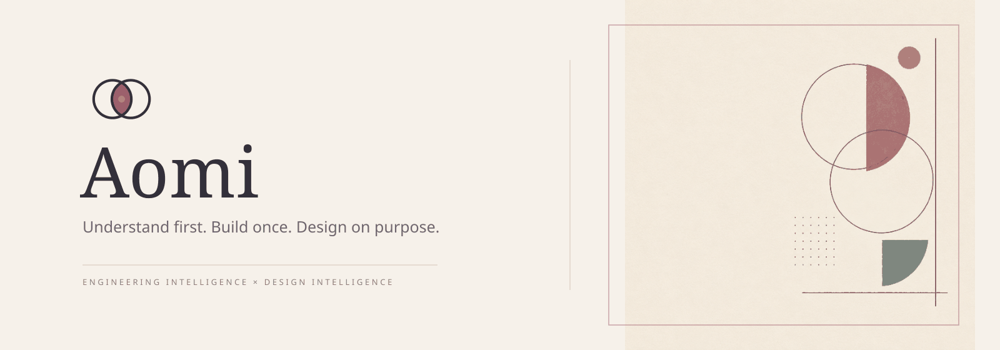
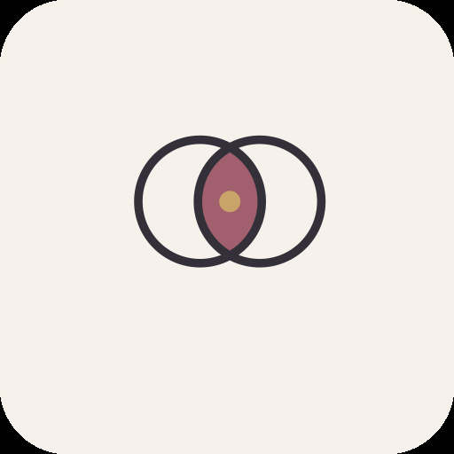
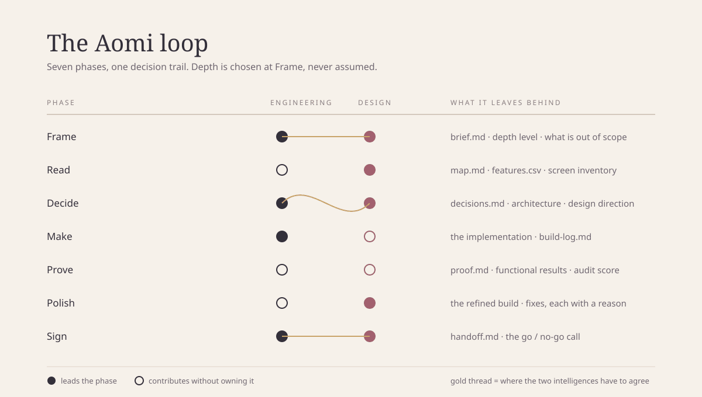

<p align="center">
  
</p>

# Aomi

**Understand first. Build once. Design on purpose.**

`lisensi: Aomi Personal Use v1.0` · `python 3.9+` · `tanpa dependency` · `v1.0.0`

---

## haii, kenalin Aomi

Aomi itu skill buat AI agent supaya nggak asal ngoding.

Kebanyakan agent (dan kebanyakan manusia juga, sih) langsung buka editor begitu
dikasih tugas. Hasilnya kelihatan cepat, tapi minggu ketiga baru ketahuan: datanya
salah bentuk, satu layar punya dua sistem warna, dan halaman itu ternyata bisa
ditukar logo dengan produk lain tanpa ada yang sadar.

Aomi dibalik urutannya. Pahami dulu, tulis keputusannya sekali, baru bangun. Dan
kalau UI-nya kelihatan generik, itu dianggap bug, bukan selera.

Aomi bukan kumpulan file yang digabung dari mana-mana. Ini implementasi baru,
ditulis dari nol, dengan filosofi, arsitektur, dan bahasa desainnya sendiri.

## tagline, dan kenapa yang itu

Tiga calon yang sempat dipertimbangkan:

1. *Think deeper. Build better. Design differently.*
2. *Less slop, more thought.*
3. **Understand first. Build once. Design on purpose.**

Yang dipilih nomor tiga, karena dia menyebut tiga hal yang memang bisa diperiksa:
pemahaman sebelum kerja, satu kali bangun yang benar, dan desain yang punya alasan.
Dua yang lain enak dibaca tapi tidak bisa dibuktikan.

## yang bisa Aomi lakuin



Satu loop, tujuh fase. Engineering dan design jalan bareng, bukan dua skill yang
saling tidak tahu.

- baca sebuah produk dan memetakan layar, state, alur, serta data yang tersirat
- merancang skema data, batas kepercayaan, auth, dan jalur kegagalannya
- membangun frontend dan backend, termasuk semua state yang bikin panik
- memilih arah desain: tipografi, warna, layout, komponen, motion
- mengaudit UI dengan tiga tes, bukan daftar larangan
- menguji, mengukur, dan memutuskan boleh rilis atau belum

## fitur utama

**Loop yang menyesuaikan skala.** Ada tiga level: *Sketch* (satu komponen, satu
perbaikan), *Build* (satu fitur atau satu alur), *Product* (beberapa permukaan,
pengguna nyata). Levelnya ditulis di `brief.md`, jadi kelihatan berapa banyak
proses yang dijanjikan, dan tidak ada yang diam-diam menjalankan proses besar
untuk tugas kecil.

**Satu catatan keputusan.** Arsitektur dan arah desain hidup di file yang sama,
`decisions.md`. Tiap keputusan punya alasan dan menyebut pilihan yang kalah. Kalau
sebuah keputusan tidak punya alternatif, itu bukan keputusan, itu default.

**Slop Gate.** Tiga tes yang menjaga UI dari hasil "AI banget": Swap Test,
Derivation Test, dan signal sweep yang diukur oleh tool. Bukan daftar larangan
hitam-putih, karena ungu itu salah kalau bukan brand kamu dan benar kalau iya.

**Bukti, bukan keyakinan.** Skor paritas fitur, rasio kontras WCAG, hasil tes, dan
skor audit masuk ke `proof.md`. Bagian yang belum diuji juga ditulis di situ.

**Aturan yang bisa dijalankan.** Empat dari lima perintah di bawah adalah gate:
keluar dengan status non-nol kalau gagal, jadi bisa dipasang di pre-commit atau CI.

## Engineering Intelligence

Bagian yang menjawab *apakah ini akan tahan?*

- **Recon** untuk produk yang sudah ada: inventaris layar bertanda S01, alur
  F01 dengan jumlah langkah dan jumlah field, data yang disimpulkan, matriks
  fitur `must/should/could`. Sumber publik dan akun sendiri, dibaca dengan
  kecepatan manusia, tanpa menyentuh source code atau endpoint privat.
- **Arsitektur**: data dulu, lalu batas, lalu jalur, lalu mode kegagalan, baru
  operability. Constraint di database, bukan cuma di kode. Idempotency untuk
  semua yang bisa diulang.
- **Frontend**: state sebagai satu nilai diskriminatif, bukan lima boolean.
  Urutan bangun: shell, jalur tertipis, layar beserta seluruh state-nya, baru
  interaksi.
- **Backend**: otorisasi per record dalam satu fungsi, migrasi sebagai file,
  rahasia hanya di server, penghapusan akun yang benar-benar menghapus.
- **Quality**: reproduksi dulu, bisect permukaan, baca nilai aslinya, perbaiki
  penyebabnya sekali, lalu tulis tes yang seharusnya menangkapnya.
- **Testing**: aturan produk dulu, jalur pengguna, state yang tidak pernah
  diklik, batas. Bukti ditulis, termasuk yang tidak diuji.
- **Ship**: preflight yang dijalankan semua, rollback yang ditentukan sebelum
  deploy, dan kata "go" yang eksplisit dari pemilik produk.

## Design Intelligence

Bagian yang menjawab *apakah ini akan dipahami?*

- **Arah desain** ditulis dalam empat kalimat: siapa pembacanya dan di mana,
  apa yang harus paling jelas, terasa seperti apa (perbandingan, bukan kata
  sifat), dan sengaja bukan apa.
- **Tipografi**: enam peran dengan ukuran dan tugasnya, satu skala modular,
  maksimal tiga bobot, measure 60 sampai 75 karakter.
- **Warna**: sembilan peran, distribusi 60/30/10 sebelum memilih hex, kontras
  sebagai gate, dan dark mode sebagai palet kedua bukan hasil inversi.
- **Layout**: satu elemen dominan per area, ritme yang sengaja tidak rata, satu
  tempat yang sengaja keluar grid.
- **Komponen**: inventaris dulu (biasanya 8 sampai 12, bukan 40), lalu daftar
  state per komponen, radius dan elevasi sebagai skala yang menyatakan hierarki.
- **Interaction**: motion itu umpan balik atau noise, dengan anggaran waktu dan
  `prefers-reduced-motion` yang wajib.
- **Accessibility**: gate yang bisa dijawab dengan bukti, plus cara mengujinya
  sungguhan (keyboard, zoom 200 persen, screen reader).

## cara kerjanya

Tujuh fase, masing-masing meninggalkan satu artifact yang dibaca fase berikutnya.

| fase | yang dikerjakan | hasil |
| --- | --- | --- |
| Frame | apa yang dibangun, untuk siapa, level kedalaman, apa yang di luar scope | `brief.md` |
| Read | peta produk dan matriks fitur | `map.md`, `features.csv` |
| Decide | arsitektur dan arah desain dalam satu catatan | `decisions.md` |
| Make | jalur tertipis dulu, lalu shell, lalu tiap layar beserta state-nya | implementasi |
| Prove | tes fungsional dan audit desain, dua-duanya | `proof.md` |
| Polish | perbaiki sesuai dampak, catat keputusan yang seharusnya mencegahnya | perbaikan |
| Sign | verifikasi akhir dan keputusan go / no-go | `handoff.md` |

Sepuluh langkah penuh (pahami, analisis, riset, rencana, arah desain, bangun,
tes, audit, refine, verifikasi) dipetakan ke tujuh fase ini. Pemetaannya ada di
`core/workflow.md`.

## arsitektur

Intinya satu file rute, sisanya dimuat sesuai kebutuhan.

```text
SKILL.md          rute tugas, aturan yang tidak bisa dilanggar, perintah tool
core/             filosofi, loop, dan cara memilih kedalaman
engineering/      recon, arsitektur, frontend, backend, quality, testing, ship
design/           arah, tipografi, warna, layout, komponen, interaksi, aksesibilitas, Slop Gate
references/       pasangan font, palet dengan rasio kontras terukur, catatan per stack
templates/        kerangka artifact yang diisi saat kerja
scripts/          aomi.py dan build_assets.py, dua-duanya standard library
tests/            tes CLI, fixture bersih dan fixture penuh slop, skenario
docs/             provenance, kompatibilitas, bahasa visual
```

Kenapa dipisah begitu: instruksi memakan context window. Skill yang harus dibaca
seluruhnya sebelum mulai akan dibaca sekilas. Jadi `SKILL.md` memilih file, dan
agent hanya membuka yang relevan. Tidak ada instruksi yang ditulis dua kali.

## instalasi

Tanpa dependency. Cukup Python 3.9 atau lebih baru untuk tool-nya; skill-nya
sendiri hanya file Markdown.

```bash
git clone https://github.com/AomiXplorer/aomi.git
cd aomi
python3 scripts/aomi.py --version
```

Pasang ke agent kamu, pilih salah satu:

```bash
# Base44 Superagent, atau agent yang membaca .agents/skills/
mkdir -p .agents/skills && cp -r . .agents/skills/aomi

# Claude Code, gaya direktori skill
mkdir -p ~/.claude/skills && cp -r . ~/.claude/skills/aomi

# Cursor / Windsurf / Copilot / Codex: taruh SKILL.md di root rule atau
# instructions folder yang mereka baca, lalu biarkan file lain di sebelahnya
cp SKILL.md /path/ke/project-rules/aomi.md
```

Untuk opsi terakhir, salin seluruh direktori, bukan hanya `SKILL.md`, karena
`SKILL.md` merujuk file di `core/`, `design/`, dan seterusnya.

## contoh pakai

Mulai sebuah project kecil:

```bash
python3 scripts/aomi.py init .
# aomi/brief.md, decisions.md, proof.md, features.csv
```

Audit UI yang sudah ada:

```bash
$ python3 scripts/aomi.py audit ./src
SG01  w3  violet-indigo accent with no brand basis  [measured]
    - landing.html: #a855f7
SG15  w4  proof that cannot be traced  [measured]
    - landing.html: Trusted by 12,400

penalty 7  ->  score 51/100  ->  BLOCKED
```

Kalau ungunya memang brand, tulis alasannya, dan skornya berubah:

```json
// aomi/overrides.json
[{ "signal": "SG01", "reason": "brand",
   "note": "Logo dan materi cetak memakai #6D4AA6, antarmuka mengikutinya." }]
```

Cek kontras sebelum menyesal:

```bash
$ python3 scripts/aomi.py contrast aomi/tokens.json
pass    14.85    4.5  body on ground
FAIL     1.96    4.5  faint on ground
4 pairs, 1 failing
```

Skor paritas fitur, dan apakah boleh rilis:

```bash
$ python3 scripts/aomi.py parity aomi/features.csv
Parity 50.0/100   (5 features)
must-haves: 1/2

Not shippable yet:
  - booking: Time zone detection (partial)
```

Kesehatan repo dan referensinya:

```bash
$ python3 scripts/aomi.py doctor
0 errors, 0 warnings
```

## agent yang didukung

Statusnya dibedakan dengan jelas: apa yang sudah diuji, dan apa yang secara format
seharusnya jalan.

| agent | status | catatan |
| --- | --- | --- |
| Base44 Superagent | diuji | dipasang di `.agents/skills/aomi`, dimuat dan dijalankan lewat runner skill |
| Claude Code | format cocok, belum diuji langsung | membaca `SKILL.md` dengan frontmatter `name` dan `description`; skill pihak ketiga biasanya dipasang di `~/.claude/skills/` |
| Cursor, Windsurf, Copilot, Codex | format cocok, belum diuji langsung | semua membaca aturan berbasis Markdown dari sebuah folder; taruh `SKILL.md` beserta direktori pendampingnya |
| Agent lain | tergantung | yang penting: satu sumber instruksi, tanpa duplikasi per adapter |

Satu sumber instruksi dipertahankan untuk semua adapter, supaya tidak ada dua
perilaku yang bertentangan hanya karena beda agent. Detail dan batasan ada di
`docs/compatibility.md`.

## struktur project

```text
aomi/
├── SKILL.md                    rute utama, ~140 baris
├── core/
│   ├── philosophy.md           enam prinsip
│   ├── workflow.md             tujuh fase, pemetaan sepuluh langkah
│   └── depth.md                Sketch, Build, Product, dan tanda salah pilih level
├── engineering/
│   ├── recon.md                observasi yang sah, peta produk, matriks fitur
│   ├── architecture.md         data, batas, jalur, mode kegagalan
│   ├── frontend.md             shell, state, data, form, performa
│   ├── backend.md              aturan yang tetap benar, skema, auth, job
│   ├── quality.md              debugging, review, performa, kapan refactor
│   ├── testing.md              apa yang diuji, cara menulisnya, bukti
│   └── ship.md                 preflight, environment, rollback
├── design/
│   ├── direction.md            empat kalimat, tiga daftar, enam arketipe
│   ├── typography.md           peran, skala, measure, angka
│   ├── color.md                peran, rampa, kontras, dark mode
│   ├── layout.md               skeleton, elemen dominan, ritme, responsif
│   ├── components.md           inventaris, state, skala radius dan elevasi
│   ├── interaction.md          anggaran motion, umpan balik, fokus
│   ├── accessibility.md        gate, cara uji, pola gagal
│   └── slop-gate.md            tiga tes dan lima belas signal
├── references/
│   ├── type-pairings.md        sembilan pasangan font berlisensi terbuka
│   ├── palettes.md             enam palet, rasio kontras terukur
│   └── stack-notes.md          terjemahan aturan ke Tailwind, React, platform
├── templates/                  brief, map, decisions, proof, features.csv
├── scripts/
│   ├── aomi.py                 init, audit, contrast, parity, doctor
│   └── build_assets.py         bangun ulang aset dari sumber SVG
├── tests/
│   ├── test_aomi.py            tes CLI, termasuk kesesuaian bobot dokumen dan kode
│   ├── scenarios.md            tiga skenario uji end to end
│   └── fixtures/               halaman bersih, halaman penuh slop
├── docs/
│   ├── provenance.md           audit asal-usul tiap komponen
│   ├── compatibility.md        adapter dan batasannya
│   └── design-language.md      identitas visual Aomi
├── assets/                     logo, hero, diagram workflow
├── LICENSE
└── README.md
```

## konfigurasi

Tidak ada file konfigurasi wajib. Yang opsional, dan efeknya:

| file | untuk apa | kalau tidak ada |
| --- | --- | --- |
| `aomi/overrides.json` | menerima sinyal Slop Gate tertentu dengan alasan | semua sinyal dihitung apa adanya |
| `aomi/tokens.json` | token warna dan pasangan teks yang dicek kontrasnya | `aomi.py contrast` tidak dijalankan |
| `aomi/features.csv` | kontrak scope dan skor paritas | `aomi.py parity` tidak dijalankan |

`aomi/overrides.json` hanya menerima lima alasan: `brand`, `content`,
`accessibility`, `hardware`, `legacy`. Alasan lain diabaikan, dan laporannya bilang
diabaikan. Tujuannya bukan melarang warnanya, tapi memaksa kalimat yang menjelaskan
kenapa.

## lisensi

**AOMI PERSONAL USE LICENSE v1.0.** Boleh dilihat, dipelajari, dan dipakai untuk
kebutuhan pribadi. Penggunaan komersial butuh izin tertulis. Redistribusi dan
penjualan ulang tidak diperbolehkan tanpa izin. Atribusi ke Aomi tidak boleh
dihapus, dan brand Aomi tidak boleh dipakai untuk mengklaim karya ini sebagai
milik sendiri.

Ini lisensi *source-available* buatan sendiri, bukan lisensi open source dan tidak
disetujui OSI. Teks lengkapnya ada di [LICENSE](LICENSE), termasuk bagian yang
jujur bilang bahwa dokumen ini bukan nasihat hukum dan belum diuji di pengadilan.

## credits

Terima kasih untuk dua kumpulan skill publik yang jadi bahan belajar soal cara
orang membangun alur kerja untuk agent: koleksi skill replikasi aplikasi, dan
koleksi skill anti-slop UI. Keduanya dipelajari sebagai referensi cara berpikir,
lalu Aomi ditulis ulang dari nol dengan struktur, istilah, dan sistemnya sendiri.

Tidak ada file, paragraf, aset, atau kode dari keduanya yang disalin ke sini. Kalau
kamu ingin memeriksa klaim itu, `docs/provenance.md` mencatat asal setiap bagian,
dan `python3 scripts/aomi.py doctor` memeriksa jejaknya.

Font dan aset: hero memakai artwork yang dibuat dengan model gambar, sedangkan
logo dan diagram workflow dirancang sebagai SVG di `assets/`. Teks di dalam aset
dirender lewat SVG supaya ejaannya pasti benar.

## penulis dan maintainer

**Aomi** · [github.com/AomiXplorer](https://github.com/AomiXplorer)

Dibuat karena capek lihat kode yang jalan tapi tidak dipikirkan, dan UI yang rapi
tapi tidak berarti apa-apa.

Kalau kamu menemukan sesuatu yang salah, buka issue. Kalau kamu menemukan Aomi
dipakai untuk sesuatu yang dilisensinya tidak izinkan, kabari juga.
